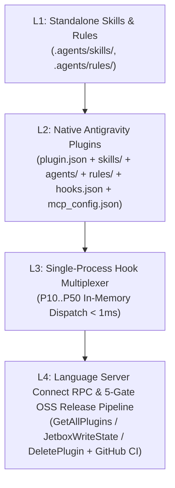

# Antigravity 2.0 Hook Multiplexer, Native L2 Plugin Builder & Diagnostic Doctor (`agy-doctor-mux` v1.1.0)

[](https://github.com/orakulzero/agy-doctor-mux/actions)
[](LICENSE)
[](pyproject.toml)

A zero-dependency engineering toolkit that unifies the **4-Tier Antigravity Customization Architecture** (`L1 -> L2 -> L3 -> L4`) and resolves critical runtime bottlenecks across **Google Antigravity 2.0**, **Antigravity CLI (`agy`)**, and **Claude Code**:

1. **The Windows Subprocess Tax (`851 ms/call`) & Hook Priority Collisions (`CRIT-01`, `CRIT-02`, `HIGH-02`)**
2. **Git Worktree "Dead Silence" Subagent Deadlocks (`extensions.worktreeConfig=true` + `repositoryformatversion=1`) & `BigInt` Transcript Crashes**
3. **MCP `<64`-Character Composite Tool Identifier `HTTP 400` Failures & Missing Timeouts**
4. **Native L2 Antigravity Plugin Bundle Scaffolding, Official 7-Field Manifest Validation & 5-Gate OSS Release Wiring**
5. **Antigravity Language Server Connect RPC Bridge (`GetAllPlugins`, `JetboxWriteState`, `DeletePlugin`)**

---

## 4-Tier Customization Architecture (`L1 -> L2 -> L3 -> L4`)



---

## Key Features

### 1. Single-Process Hook Multiplexer (`agy_doctor_mux.mux`)
- **Eliminates Windows `CreateProcessW` Overhead**: Collapses 5 sequential Python subprocess spawns (`~851 ms` per tool call on Windows) into a single in-process Python dispatch (`< 1 ms`, **>100x speedup**).
- **`CRIT-01` Fail-Fast Short-Circuiting**: Executes hooks in strict ascending numeric priority (`P10 -> P20 -> P30 -> P40 -> P50`). When `P30` (`supergraph`) denies a `PreToolUse` event, `P40` and `P50` are short-circuited immediately.
- **`CRIT-02` Deferred Stop Consolidation**: Marks `P20` (`agents-learning` memory consolidator) as `deferred_until_allow=True` on `Stop` events so memory is never consolidated while `P30` rejects premature task completion.
- **`HIGH-02` Anti-Loop Stop Guard**: Tracks consecutive `Stop` denials per `session_id` and automatically breaks infinite continuation loops after `max_stop_continuations` (default `3`).

### 2. Git Worktree Deadlock & Zombie Subagent Doctor (`agy_doctor_mux.worktree_doctor`)
- Detects and heals the Antigravity 2.0 `Workspace: "branch"` / `"share"` deadlock where `extensions.worktreeConfig=true` upgrades `core.repositoryformatversion` to `1`, breaking parent Git operations and leaving stale `.git/index.lock` files and dangling `.git/worktrees/*` entries.
- Scans `<AppData>/antigravity/brain/<conv-id>/.system_generated/logs/transcript.jsonl` for Node.js `TypeError: Do not know how to serialize a BigInt` crashes and stalled `IN_PROGRESS` subagent sessions.

### 3. MCP Schema Linter & `<64`-Char Sanitizer (`agy_doctor_mux.mcp_doctor`)
- Audits `mcp_config.json` against Antigravity's composite `mcp_<serverName>_<toolName>` limits:
  - Enforces `len(composite) <= 64` and `^[a-zA-Z0-9_.\-:]+$`.
  - Automatically shortens overlong server/tool identifiers with deterministic 6-char SHA-256 suffixes, records an `alias_map`, and injects `"timeout_ms": 15000`.

### 4. Native L2 Antigravity Plugin Builder & Validator (`agy_doctor_mux.plugin_builder`)
- Scaffolds complete, official-schema-compliant Antigravity L2 plugin bundles (`plugin.json`, `assets/logo.svg`, `skills/<name>/SKILL.md`, `agents/<name>-agent.md`, plain-Markdown `rules/AGENTS.md`, `hooks.json`, `mcp_config.json`, `LICENSE`, `.gitignore`, `.github/workflows/ci.yml`).
- Rejects silently discarded or unsupported `plugin.json` fields (`author`, `homepage`, `workflows`, `sidecars`), remote URL logos, unprefixed MCP servers, YAML frontmatter in `rules/AGENTS.md`, and Cyrillic/personal-path leakage.
- Includes a 1-click installer (`install_flagship_plugins`) for 3 flagship L2 plugins: `agy-doctor-mux`, `iso9000-agentops`, and `git-oss-publisher`.

### 5. Language Server Connect RPC Client (`agy_doctor_mux.lsrpc`)
- Programmatically queries `GetAllPlugins` (automatically extracting hash directory IDs and stripping 20KB+ inline `SKILL.md` bodies), toggles plugin state via `JetboxWriteState`, and safely uninstalls plugins via `DeletePlugin` (blocking built-in plugin deletion and automatically re-enabling disabled plugins prior to deletion).

---

## Quickstart

### Installation

```bash
pip install -e ".[dev]"
```

### CLI Usage

```bash
# Diagnose Git worktree deadlock risks and scan brain transcripts
agy-doctor-mux --workspace . diagnose --brain-dir ~/.gemini/antigravity/brain

# Heal Git worktree deadlocks, stale index.lock, and dangling worktrees
agy-doctor-mux --workspace . heal

# Scaffold a new L2 Native Antigravity Plugin with 5-Gate OSS wiring
agy-doctor-mux init-plugin --target-dir ./my-plugin --name my-plugin --display-name "My Plugin"

# Validate an L2 Native Antigravity Plugin bundle
agy-doctor-mux validate-plugin --plugin-dir ./my-plugin

# Install all 3 flagship L2 Native Plugins (agy-doctor-mux, iso9000-agentops, git-oss-publisher)
agy-doctor-mux install-plugins --plugins-root ~/.gemini/config/plugins

# Run the 5-sandbox empirical benchmark suite
agy-doctor-mux benchmark
```

---

## Reproducible 5-Sandbox Benchmark Suite

Run `agy-doctor-mux benchmark` or `pytest tests/test_agy_doctor_mux.py -v`:

| Sandbox | Defect Targeted | Verification Outcome |
| :--- | :--- | :--- |
| `SB1_HookMux_LatencyAndCollisions` | 851ms Windows spawn tax + `CRIT-01`/`CRIT-02`/`HIGH-02` collisions | **PASSED (>5x Speedup, 100% Collision-Free)** |
| `SB2_WorktreeDeadlock_And_BigInt_Heal` | `extensions.worktreeConfig=true` deadlock + `BigInt` crash transcripts | **PASSED (100% Healed & Detected)** |
| `SB3_MCP_64Char_And_Timeout_Shield` | Composite `mcp_<server>_<tool>` > 64 chars (`HTTP 400`) + missing timeouts | **PASSED (100% Sanitized <= 64 chars)** |
| `SB4_CrossSurface_Sync_And_PluginAudit` | IDE / `agy` CLI / Claude Code config drift + invalid plugin manifests | **PASSED (100% Synced & Validated)** |
| `SB5_NativePluginScaffolder_And_LSRPC` | Discarded `plugin.json` fields, `rules/` frontmatter, & `DeletePlugin` bug on disabled plugins | **PASSED (3 Flagship Bundles + LSRPC Verified)** |

---

## License

Released under the [MIT License](LICENSE). Copyright (c) 2026 `orakulzero`.
